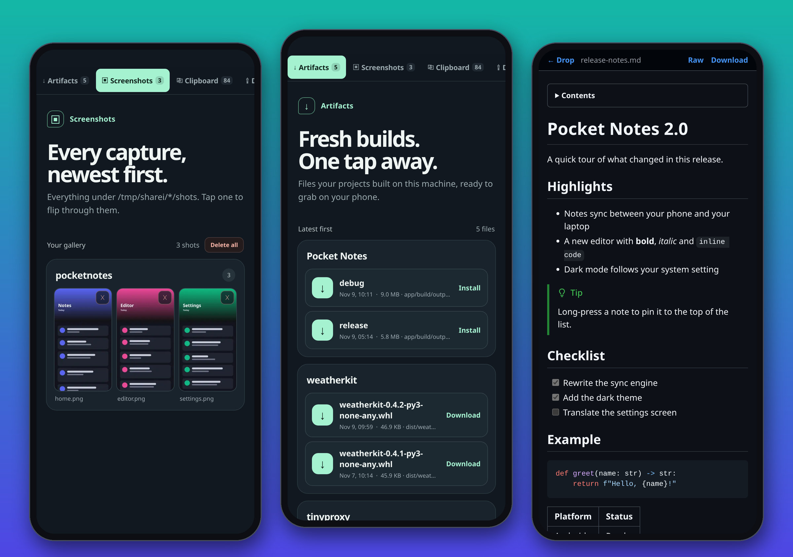
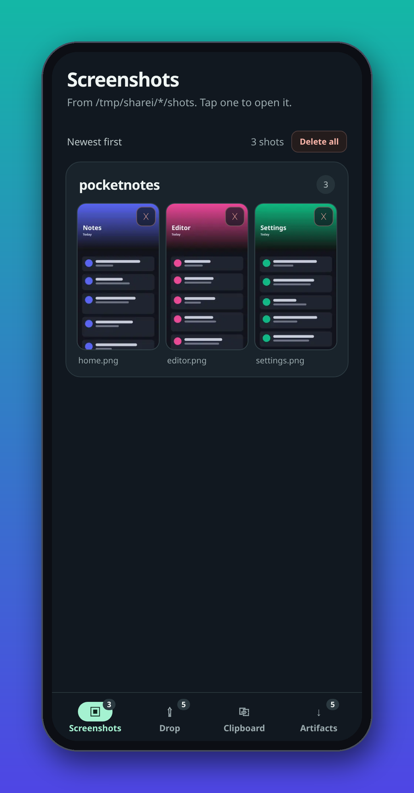
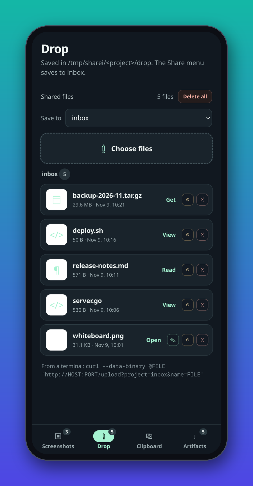
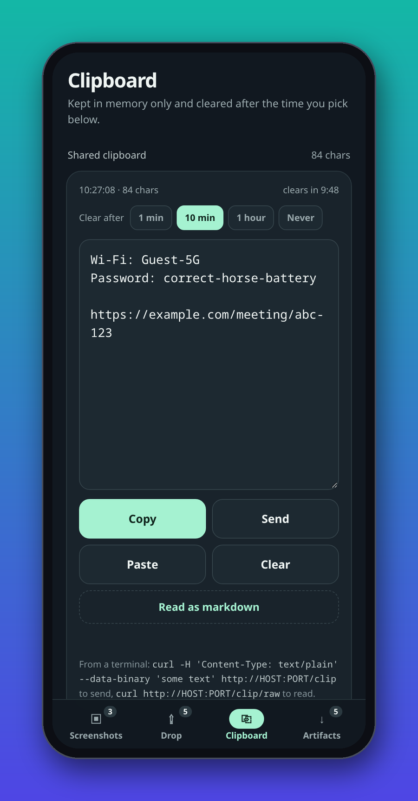
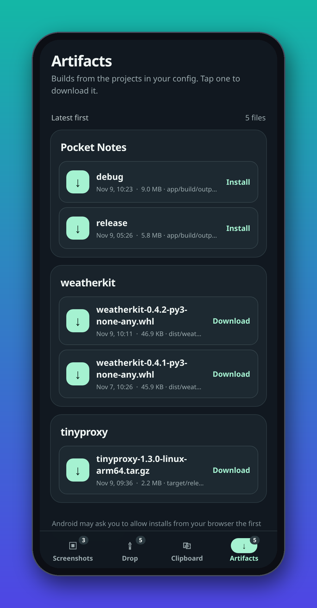
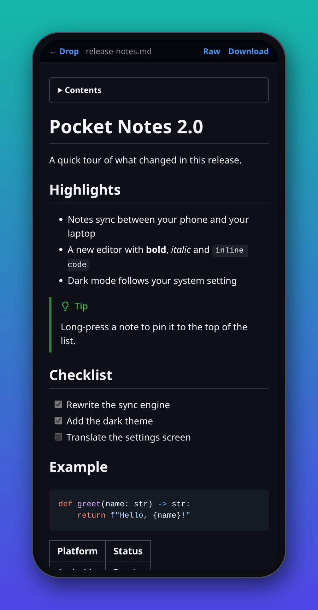
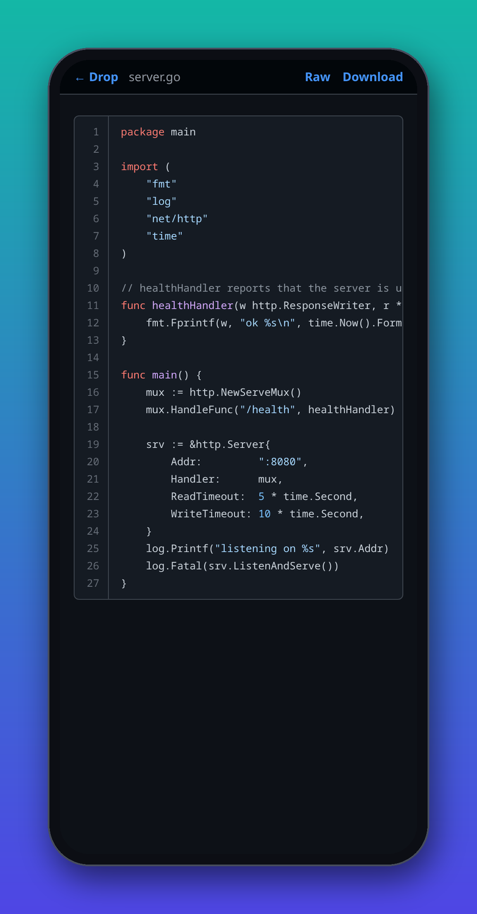
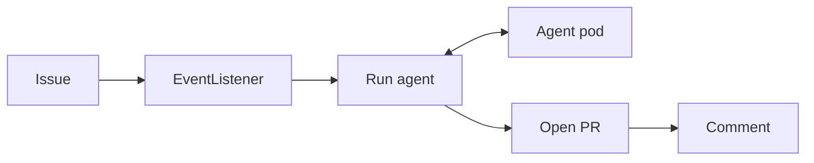
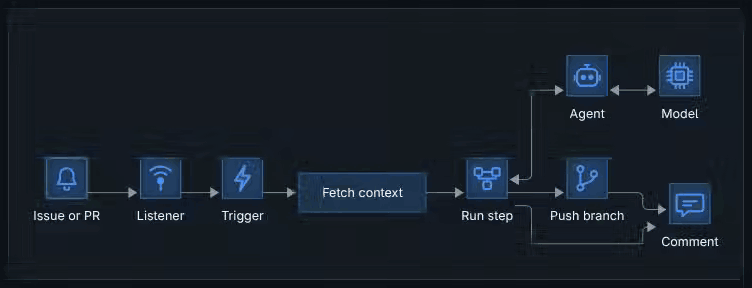

# sharei

sharei is a small web page that runs on your computer and that you open on
your phone. It gets the app you just built, your screenshots, a bit of text or
a file over to the other device, without cables or a cloud drive.



## What you get

The page has four tabs (five with Notes), along the bottom on a phone and down the left side
on a computer.

Screenshots lists what you saved, grouped by project. Open one and tap the
left or right side to turn to the previous or next screenshot, like a book; a
tap in the middle closes the viewer. Swiping works too. You can draw arrows
and notes on them, and set them to disappear after a while. SVG files count as
screenshots too.

Drop holds files you send either way. Markdown opens in a reader made for long
documents, with any front matter drawn as a list of properties. Code opens with
colours and line numbers, pictures full screen (SVG too, drawn by your browser),
videos and audio play in the page, and PDFs open page by page, even on phones
that would otherwise only download them. An iPhone HEIC photo arrives as a
JPEG (a PNG when it has transparency) when the thumbnails extra is installed.
Any file there can be set to expire. Pressing Ctrl+V (⌘+V on a Mac) on the
Drop page uploads what you copied: files, a screenshot, or text, which is
saved as a `.txt` file.

Clipboard is a shared note. Paste on one device and copy on the other.
It clears itself after ten minutes unless you change that. The last five
notes you replaced stay underneath, each on its own timer, so you can copy
one again or put it back. Clear forgets the current note for good. When the
note is a web address, it shows up as a link you can tap.

To move a page or a link to another device, press the QR button. It sits on
the clipboard link, in the header of a markdown, code or video page, and next
to a file in Drop on a computer. The phone camera opens it straight away. Set
`qr = false` in the config file to hide these buttons.

Artifacts lists the files your projects build, newest first: Android APKs,
Python wheels, release archives, whatever you point it at. Tap one on your
phone to download it, or to install it if it is an APK.

Notes shows a few folders of your Obsidian vault, read only, when you set it
up (see below).

| Screenshots | Drop | Clipboard |
|---|---|---|
|  |  |  |

| Artifacts | Markdown | Code |
|---|---|---|
|  |  |  |

The round button at the top right of each page picks a colour theme: light,
dark, Dracula, Tokyo Night, Rosé Pine or Rosé Pine Dawn. Auto, the default,
follows your device. Each browser remembers its own choice, and the `theme`
setting picks the default for browsers that haven't chosen yet.

If you add sharei to your Android home screen, it shows up in the Share menu,
so you can send a link, some text or a photo from any app to your computer.
Going the other way, the ↗ button on a screenshot (or in the viewer toolbar)
and on a picture in Drop hands the file to another app through the system
share sheet: WhatsApp, Mail, Files, whatever you pick.

## Install

You need Python 3.12 or newer and [uv](https://docs.astral.sh/uv/).

```sh
uv tool install git+https://github.com/chmouel/sharei
sharei
```

Open <http://localhost:8000> to check that it runs. For small thumbnails of
big screenshots, install `'sharei[thumbnails] @ git+https://github.com/chmouel/sharei'`
instead: it also turns the HEIC photos an iPhone sends into JPEG on arrival,
which every browser can show.

To start it with your session on Linux, copy
[`contrib/sharei.service`](contrib/sharei.service) to
`~/.config/systemd/user/` and run:

```sh
systemctl --user enable --now sharei
```

## Notifications

sharei can tell your phone when a file, a screenshot or new clipboard text
arrives. Install it with the push extra:

```sh
uv tool install 'sharei[push] @ git+https://github.com/chmouel/sharei'
```

Then open sharei on the phone and tap the bell at the top, next to the theme
button. Browsers only allow this on an HTTPS address (or
`localhost`), so it works through your reverse proxy. On an iPhone, add sharei
to the home screen first and turn notifications on from there. Set
`push_subject` in the config to your email address.

Whatever you send from a device doesn't notify that same device. Several
uploads close together arrive as one notification.

## Open it on your phone

sharei has no password of its own, and by default only your computer can reach
it. To use it from your phone, put it behind a reverse proxy that asks for a
password, such as Caddy or nginx with basic auth. Then tell sharei the address
you use, in `~/.config/sharei/config.toml`:

```toml
allow_hosts = ["share.example.com"]
allow_origins = ["https://share.example.com"]
```

A minimal Caddy setup:

```caddy
share.example.com {
    basic_auth {
        me <hash from `caddy hash-password`>
    }
    reverse_proxy localhost:8000
}
```

On a home network you fully trust, you can set `host = "0.0.0.0"` instead and
open `http://<your computer's address>:8000`. Anyone else on that network can
then use sharei too. [SECURITY.md](SECURITY.md) has more on this.

QR codes use the address in your browser. If you browse sharei on your
computer as `localhost`, add the address your phone uses so the codes work
there:

```toml
public_url = "https://share.example.com"
```

## Tell it where your builds are

Add an `[[artifacts]]` entry per project to the config, with the folder and the
files to show:

```toml
[[artifacts]]
name = "My app"
root = "~/src/my-app"
patterns = ["app/build/outputs/apk/**/*.apk"]
```

`**` stands for any number of folders. To cover every project in a folder at
once, give a wildcard as the root:

```toml
[[artifacts]]
root = "~/src/*"
patterns = ["dist/*.whl", "target/release/*.tar.gz"]
```

Precise patterns like `dist/*.whl` keep the page fast. A pattern starting with
`**` has to look through the whole project. sharei also picks up builds in your
git worktrees. [`config.example.toml`](config.example.toml) lists every other
setting.

## Read your Obsidian notes

Pick the vault folders you want to read from your phone:

```toml
[notes]
vault = "~/Notes"
folders = ["Travel", "Recipes"]
```

The Notes tab then lists those folders, with a box to find a note by name.
Notes open in the same reader as markdown in Drop, and understand Obsidian's
own writing: links and embeds between notes, callouts (folded ones too),
==highlights==, #tags, and %%comments%%, which stay hidden. Pictures and PDFs
kept elsewhere in the vault show up only when one of these notes uses them.
Icons given to notes and folders with the Icon Fairy plugin show up too.
Everything else in the vault stays private: a link to a note outside the
chosen folders shows as plain text. Nothing is ever changed in the vault.

To jump to a note from any page, press `/` or Ctrl+K (Cmd+K on a Mac), or tap
the magnifier. Type a few letters of its name, in any order of words, and
press Enter. Switch to Text, or press Tab, to search inside the notes
instead: each matching line is listed, and opening one scrolls the note to
that line with the words highlighted. Neither search cares about case or
accents.

## Share from the terminal

`sharec` comes with sharei and sends things to it:

```sh
sharec notes.md          # formatted markdown, with the pictures it uses
sharec main.go           # code, with colours and line numbers
sharec -s                # take a screenshot and send it
sharec -c                # send the clipboard text as a markdown note
sharec                   # pick from a menu
```

It prints the link to open on your phone, or the details as JSON with
`--json`. Inside a git repository, files go to a project named after it;
`-p` or `SHAREI_PROJECT` picks another. A markdown file's pictures are only
sent after you say yes, or straight away with `-y`.

Set `SHAREI_PUBLIC_URL` to your public address (for example
`https://share.example.com`) so those links work away from home. On a machine
where sharei is not running, `sharec` then talks to that address. If it sits
behind a password, put it in `~/.netrc`, or name a
[pass](https://www.passwordstore.org/) entry in `SHAREI_PASS_ENTRY` (password
on the first line, `user: NAME` on a later one). The menu needs
[gum](https://github.com/charmbracelet/gum). Zsh completion lives in
[`contrib/_sharec`](contrib/_sharec).

To set the shared clipboard:

```sh
sharec clip 'some text'  # share a line of text
git diff | sharec clip   # or whatever comes in on a pipe
sharec clip --ttl 3600   # keep it an hour (0 keeps it until replaced)
sharec clip --clear      # empty it
```

It can fetch things back too:

```sh
sharec get               # print the shared clipboard
sharec get clip 1 -c     # put the previous clipboard note on this clipboard
sharec get shot          # show the newest screenshot in the terminal
sharec get drop          # show the newest dropped file, image or text
sharec get drop -f       # download it here instead
sharec get shot 1 -o a.png  # save the previous screenshot as a.png
sharec get list          # what is on sharei right now
sharec get list --json   # the same, for scripts
sharec get clip --json   # the clipboard and its history
sharec notes             # the shared notes and folders
sharec notes ramen       # every note holding "ramen", with the matching lines
sharec cat /notes-file/Journal/today.md   # a route, byte for byte
sharec cp 'some text'    # put text on this machine's clipboard
```

Links in `--json` are absolute, so a script can open them as is. `sharec
notes --json` and `sharec cat` are what a launcher needs: raffi has a
[script filter](contrib/raffi/) that lists the notes, the clipboard, the drops
and the screenshots from its search box.

Coding agents that support skills (Claude Code, Copilot CLI, Codex and the
like) can use [`contrib/skills/sharei`](contrib/skills/sharei/SKILL.md): copy
or link that folder into the agent's skills directory and it will read what
you shared, hand you reports as `/md` pages and draw walkthrough diagrams.

Images show up right in terminals that speak the kitty graphics protocol
(kitty, Ghostty, WezTerm, Konsole). The image fills the window: j, Space or
→ shows the next older one, k, Backspace or ← the newer one, going round in a
loop. D deletes it from sharei after you confirm with D or y. Any other key
closes it and puts the terminal back as it was.
JPEG, GIF and WebP need the thumbnails
extra; files that can't be shown are saved in the current folder, and SVG
files, which no terminal can draw, are always saved. When the
output goes to a pipe or a file, you get the file itself. Downloads never
overwrite a file; they become `name-1.ext` instead.

To comment on a markdown file, press the speech bubbles in its header.
Line numbers appear next to the text; tap one, or tap a second to take a
range, and write your note. Copy as prompt puts every comment on the
clipboard, ready to paste back to whoever wrote the file, and
`sharec get comments plan.md` prints the same thing. Send a revised version
with `sharec plan.md --replace` and the comments stay: those on lines that
moved follow them, and those on lines that changed are marked as such.

## Diagrams

Mermaid diagrams in a markdown file are drawn in the reader. Drag one to move
around, pinch or Ctrl+scroll to zoom, and press the corner button to see it
full screen.

When you present, click a box in a flowchart to point at it: it lights up
with its arrows and neighbours, and the rest of the diagram fades. Shift-click
adds more boxes. Click the box again, the background or press Escape to bring
everything back.

A flowchart can also play a walkthrough: a dot carrying a label travels from
box to box, the box it reaches lights up, and the ones it has left get a tick.
Write the steps as `%%` comments inside the diagram, which GitHub and other
mermaid renderers ignore:

````markdown

````

Each `%% A -> B` step uses the node ids, follows the arrow drawn between
those two boxes (backwards too), and can carry a label after `:`. A
sentence after `|`, as in `%% A -> B : #42 | A user opens an issue`, shows
under the diagram while that step plays. `%% skip`
fades boxes that a scenario does not use, and `%% play: title` starts
another scenario, picked from a menu next to the play button. A step that
names a missing box or arrow is ignored and listed when you hover the play
button. The arrows on each side of the play button go through the story
one step at a time while you talk over it, and so do the right and left
arrow keys, `j` and `k`, while Space plays or pauses. The thin rail under
the controls has a tick per step; click one to jump there. The camera
button makes the view zoom in on each step as it plays and back out at the
end, which helps on large diagrams. When your system
asks for less motion, the boxes change one after another and nothing
travels.
"Copy link" in the share menu gives an address that opens the diagram in
full screen at the same story, step and highlighted boxes. The pen button
turns your pointer into a fading laser trail, and dragging with it draws
on the diagram; Escape wipes the drawing.



The share button next to the story controls saves the selected scenario as a looping
GIF or as a video (MP4, or WebM in browsers that can't write MP4), made in
your browser. Every diagram, story or not, has that share button: "PNG"
saves a picture of exactly what you see, zoom, highlights and caption
included, and "Copy link" keeps the highlighted boxes.

A box can show a picture with mermaid's own syntax,
`Bot@{ img: "bot.svg", label: "Agent", pos: "b", w: 40, h: 40 }`. Put the
picture next to the markdown file and `sharec` sends it along, or use an
https link. sharei also comes with about a hundred icons for agents, pull
requests, pipelines, pods, tokens and the like: write
`img: "/icons/agent.svg"` and nothing needs uploading. A picture that fails to load is replaced by a placeholder and
named when you hover the diagram. The
[walkthrough design notes](docs/diagram-walkthroughs.md) have the full syntax
and a demo you can play.

## Privacy

Everything stays on your computer. Markdown is formatted by your own browser,
so even a private document never leaves it.

With notifications on, each notification (a file name or the start of the
clipboard text) travels through your browser maker's push service (Google,
Mozilla, Apple). It is encrypted for your browser, so the service can't read it.

## Licence

Apache 2.0. sharei bundles github-markdown-css, markdown-it, DOMPurify,
mermaid, highlight.js, qrcode-generator, pdf.js and marker.js, with their
licences next to them in
`src/sharei/vendor/`.
