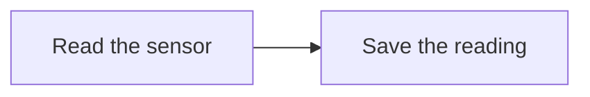
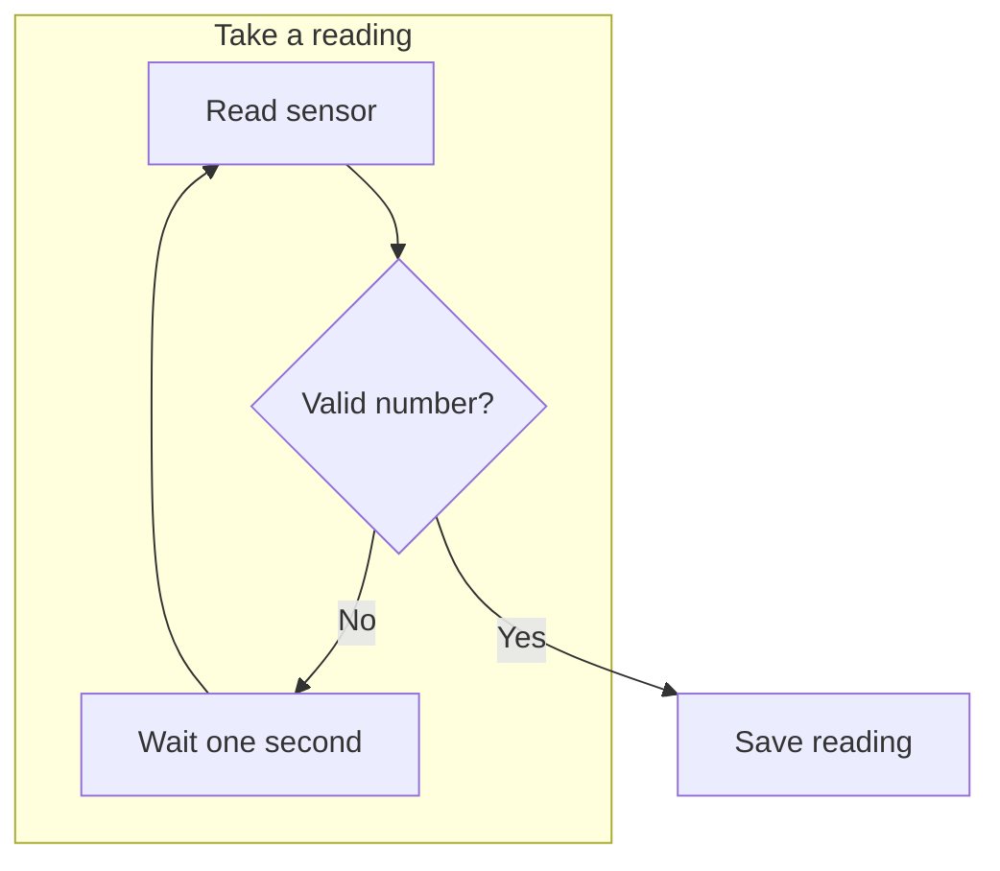
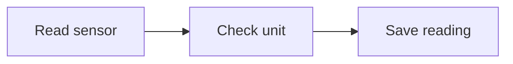
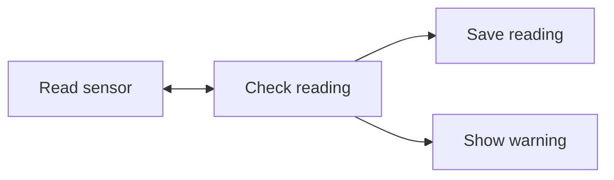
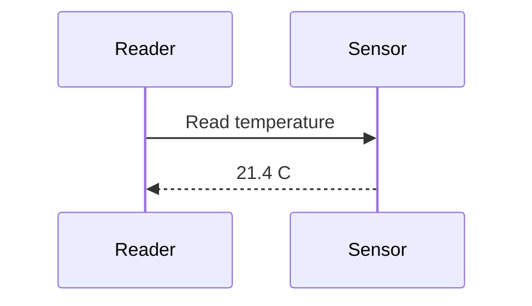
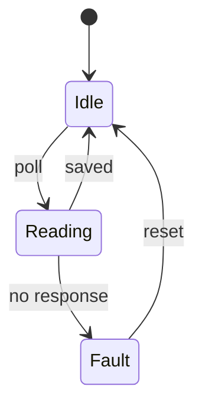
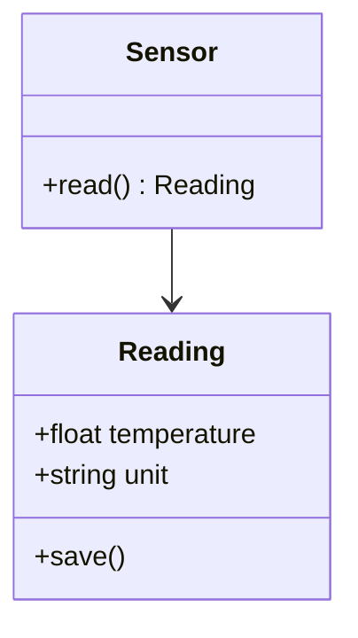
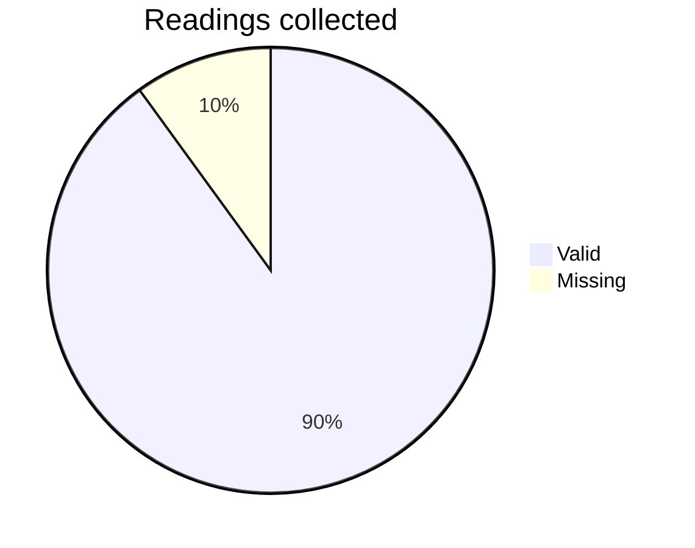

# See it in motion

Follow a fix from issue to release. Press **Play demo**, or take it one step
at a time. Switch stories to see a failed test and a retry.

<section class="aniflow-demo">

```mermaid
%%{init: {"flowchart": {"nodeSpacing": 18, "rankSpacing": 18}}}%%
flowchart LR
  Issue@{ img: "/icons/issue.svg", label: "Issue", w: 48, h: 48, constraint: "on" }
  Agent@{ img: "/icons/agent.svg", label: "Agent", w: 48, h: 48, constraint: "on" }
  Model@{ img: "/icons/model.svg", label: "Model", w: 48, h: 48, constraint: "on" }
  Test@{ img: "/icons/test.svg", label: "Tests", w: 48, h: 48, constraint: "on" }
  Review@{ img: "/icons/reviewer.svg", label: "Review", w: 48, h: 48, constraint: "on" }
  Ship@{ img: "/icons/deploy.svg", label: "Release", w: 48, h: 48, constraint: "on" }
  Issue --> Agent
  Agent <--> Model
  Agent <--> Test
  Agent --> Review --> Ship

%% play: Ship a fix
%% Issue -> Agent : #42 | A reader reports the bug.
%% Agent -> Model : context | Read the code and propose a change.
%% Model -> Agent : patch | Apply the fix and add a regression test.
%% Agent -> Test : run | Check the fix before opening a pull request.
%% Test -> Agent : pass | The checks pass. Prepare the pull request.
%% Agent -> Review : PR | A reviewer checks the code and regression test.
%% Review -> Ship : approved | Merge the fix and publish the release.

%% play: Fix a failing test
%% skip Review Ship | This story stops when the revised tests pass.
%% Issue -> Agent : #42 | Start with the same report.
%% Agent -> Model : context | Ask for a first patch.
%% Model -> Agent : patch
%% Agent -> Test : run
%% Test -> Agent : failed | The regression test found a missing case.
%% Agent -> Model : failure | Send the failing assertion back with the code.
%% Model -> Agent : revised | Handle the missing case.
%% Agent -> Test : rerun | Run the checks again.
%% Test -> Agent : pass | The revised test passes. The patch is ready for review.
```

</section>

Click a box to spotlight its connections. Drag to pan, zoom with the toolbar,
or open full screen for a closer look. The share menu saves a PNG, GIF or video.

<details class="example-source">
<summary>Show the demo's Markdown</summary>

````markdown
```mermaid
%%{init: {"flowchart": {"nodeSpacing": 18, "rankSpacing": 18}}}%%
flowchart LR
  Issue@{ img: "/icons/issue.svg", label: "Issue", w: 48, h: 48, constraint: "on" }
  Agent@{ img: "/icons/agent.svg", label: "Agent", w: 48, h: 48, constraint: "on" }
  Model@{ img: "/icons/model.svg", label: "Model", w: 48, h: 48, constraint: "on" }
  Test@{ img: "/icons/test.svg", label: "Tests", w: 48, h: 48, constraint: "on" }
  Review@{ img: "/icons/reviewer.svg", label: "Review", w: 48, h: 48, constraint: "on" }
  Ship@{ img: "/icons/deploy.svg", label: "Release", w: 48, h: 48, constraint: "on" }
  Issue --> Agent
  Agent <--> Model
  Agent <--> Test
  Agent --> Review --> Ship

%% play: Ship a fix
%% Issue -> Agent : #42 | A reader reports the bug.
%% Agent -> Model : context | Read the code and propose a change.
%% Model -> Agent : patch | Apply the fix and add a regression test.
%% Agent -> Test : run | Check the fix before opening a pull request.
%% Test -> Agent : pass | The checks pass. Prepare the pull request.
%% Agent -> Review : PR | A reviewer checks the code and regression test.
%% Review -> Ship : approved | Merge the fix and publish the release.

%% play: Fix a failing test
%% skip Review Ship | This story stops when the revised tests pass.
%% Issue -> Agent : #42 | Start with the same report.
%% Agent -> Model : context | Ask for a first patch.
%% Model -> Agent : patch
%% Agent -> Test : run
%% Test -> Agent : failed | The regression test found a missing case.
%% Agent -> Model : failure | Send the failing assertion back with the code.
%% Model -> Agent : revised | Handle the missing case.
%% Agent -> Test : rerun | Run the checks again.
%% Test -> Agent : pass | The revised test passes. The patch is ready for review.
```
````

</details>

## Build your own

Start with a page, then add diagrams and playback. Open any “Show the Markdown”
section to copy its example. More in the header has the source for this whole guide.

## Step 1: Open a folder

Run this in the directory that holds your Markdown:

```sh
uvx --from git+https://github.com/chmouel/sharei aniflow
```

Open the URL in the terminal. aniflow picks an available port on localhost.
Choose a folder, then a `.md` or `.markdown` file. The breadcrumbs take you
back through its parent folders.

To serve a specific directory on a fixed port:

```sh
aniflow ./docs --port 8080
```

After you edit a file, refresh the browser to read the saved version.
aniflow does not change the files it serves.

## Step 2: Write a page

Create `first.md` with this text:

<details class="example-source">
<summary>Show the Markdown</summary>

```markdown
# Weekend project

Build a small weather station.

## Parts

- A temperature sensor
- A spare laptop

## First reading

The sensor reports **21 degrees**.
```

</details>

`#` starts a heading. Add another `#` for a smaller heading. Put a blank
line between paragraphs. A single line break inside a paragraph stays in
the same paragraph.

Open the file. Contents lists its headings; on a wide screen, it sits beside
the text and follows your position. The line under the header shows your
reading progress. Hover over a heading to find its `#` link and copy the
address to point someone to that section.

## Step 3: Format text and track tasks

<details class="example-source">
<summary>Show the Markdown</summary>

```markdown
Use **bold** for a result, *italics* for emphasis, and `code` for a name.
~~Replace the old sensor.~~ Keep the working one. :rocket:

- [x] Connect the sensor
- [ ] Record a reading
- [ ] Check the units

1. Plug in the cable.
2. Run the script.
```

</details>

Use **bold** for a result, *italics* for emphasis, and `code` for a name.
~~Replace the old sensor.~~ Keep the working one. :rocket:

- [x] Connect the sensor
- [ ] Record a reading
- [ ] Check the units

1. Plug in the cable.
2. Run the script.

Change the checkboxes in your source file. The reader displays them without
editing your file.

## Step 4: Add code and tables

Put a language name after the opening backticks to colour the code.

<details class="example-source">
<summary>Show the Markdown</summary>

````markdown
```python
from pathlib import Path

for note in Path("docs").rglob("*.md"):
    print(note)
```

| Sensor | Reading | Unit |
| --- | ---: | --- |
| Desk | 21.4 | Celsius |
| Garden | 14.8 | Celsius |
````

</details>

```python
from pathlib import Path

for note in Path("docs").rglob("*.md"):
    print(note)
```

| Sensor | Reading | Unit |
| --- | ---: | --- |
| Desk | 21.4 | Celsius |
| Garden | 14.8 | Celsius |

The Copy button copies the code without its backticks. The colon in `---:`
aligns that table column to the right. Use `:---:` to centre it.

## Step 5: Link files and show pictures

Keep a document and its pictures in the folder you serve:

```text
docs/
  README.md
  guides/
    sensor.md
  images/
    wiring.png
```

Inside `guides/sensor.md`, write:

<details class="example-source">
<summary>Show the Markdown</summary>

```markdown
[Back to the overview](../README.md)
[The calibration section](../README.md#calibration)

```

</details>

Paths start beside the document. `../` moves up one folder; a leading `/`
starts at the folder you served. Spaces work too:

<details class="example-source">
<summary>Show the Markdown</summary>

```markdown
[Bench notes](<bench notes.md>)

```

</details>

For a picture you can try without creating a file, use a built-in icon:

<details class="example-source">
<summary>Show the Markdown</summary>

```markdown

```

</details>


The [icon list](/icons/) gives you the available names as JSON. Local
pictures stay inside the served folder. Hidden paths and symlinks leading
outside that folder return 404.

## Step 6: Add properties and footnotes

Put YAML properties on the first line of a document, between two `---`
lines. aniflow shows them in a properties panel above your text.

<details class="example-source">
<summary>Show the Markdown</summary>

```markdown
---
title: Weather station
date: 2026-11-12
ready: true
tags: [hardware, notes]
parts:
  - sensor
  - cable
summary: |
  Record the garden temperature.
  Compare it with the desk sensor.
---

# Weather station
```

</details>

Dates use your browser's date format. Booleans show as Yes or No, and lists
show as pills. This panel handles common properties; nested YAML stays
visible as code.

Use a footnote for a detail that would interrupt the paragraph:

<details class="example-source">
<summary>Show the Markdown</summary>

```markdown
Record the unit with each reading.[^units]

[^units]: A number without a unit is hard to compare later.
```

</details>

Record the unit with each reading.[^units]

## Step 7: Add alerts and fold long details

A `>` starts a quotation. An alert adds its type on the first line:

<details class="example-source">
<summary>Show the Markdown</summary>

```markdown
> [!NOTE]
> Save the reading with its unit.

> [!TIP]
> Take a photo before you unplug the wires.

> [!IMPORTANT]
> Check the sensor's voltage rating.

> [!WARNING]
> Disconnect power before changing the wiring.

> [!CAUTION]
> Reversing the supply can damage the sensor.
```

</details>

> [!NOTE]
> Save the reading with its unit.

> [!TIP]
> Take a photo before you unplug the wires.

> [!IMPORTANT]
> Check the sensor's voltage rating.

> [!WARNING]
> Disconnect power before changing the wiring.

> [!CAUTION]
> Reversing the supply can damage the sensor.

Use `<details>` for a section readers can open when they need it. Leave a
blank line after the summary so Markdown inside it renders.

<details class="example-source">
<summary>Show the Markdown</summary>

````markdown
<details>
<summary>Calibration notes</summary>

Take two readings ten minutes apart.

```text
Desk:   21.4 C
Garden: 14.8 C
```

</details>
````

</details>

<details>
<summary>Calibration notes</summary>

Take two readings ten minutes apart.

```text
Desk:   21.4 C
Garden: 14.8 C
```

</details>

## Step 8: Draw your first flowchart

Use a `mermaid` code block. `LR` arranges boxes from left to right; `TD`
arranges them from top to bottom. `Read` and `Save` are node IDs. The words
inside brackets are the labels readers see.

<details class="example-source">
<summary>Show the Markdown</summary>

````markdown

````

</details>


Hover over the diagram to see its toolbar. On a phone, the toolbar stays
visible. You can zoom, drag, open full screen, or save a PNG before adding
any animation.

## Step 9: Show decisions, groups and retries

Braces draw a decision. Write an edge label between `|` characters. A
`subgraph` groups related boxes.

<details class="example-source">
<summary>Show the Markdown</summary>

````markdown

````

</details>


Click Valid number? to highlight it, its neighbours and their connecting
arrows. Click empty space to clear the spotlight. Shift-click, Ctrl-click
or Cmd-click adds or removes a box from the selection.

## Step 10: Play a flowchart one step at a time

Add `%% play:` and a list of trips between node IDs. Mermaid treats these
lines as comments; aniflow uses them for playback.

<details class="example-source">
<summary>Show the Markdown</summary>

````markdown

````

</details>


Press Next step. A dot carries `21.4 C` along the first arrow and waits at
Check unit. The sentence after `|` appears beneath the diagram. Press Next
step again to save the reading, or Play to run the whole story. Previous
step takes you back; Stop clears the playback.

`Read -> Check` names the IDs, not their labels. Draw an edge before using
it in a step. A step without `: label` still works; a step without a caption
hides the caption bar.

## Step 11: Tell different stories on one diagram

Start another `%% play:` section to add a story. `%% skip` fades boxes that
the selected story does not use. A two-way arrow lets the dot travel in
either direction.

<details class="example-source">
<summary>Show the Markdown</summary>

````markdown

````

</details>


Choose Try again in the story picker. On the return trip, the dot travels
back to the sensor on the same edge. In Good reading, the warning box fades
instead. A skip is a step too; it can have a caption after `|`.

## Step 12: Put pictures in the story

Use `@{ img: ... }` for a picture node. Set `w`, `h` and `constraint: "on"`
to keep the picture's proportions. Local paths work as they do in Markdown
images, including `../images/sensor.png`. The built-in icons need no extra
files.

This example combines pictures, a decision, two stories, captions and a
return trip:

<details class="example-source">
<summary>Show the Markdown</summary>

````markdown
```mermaid
flowchart TD
  Sensor@{ img: "/icons/terminal.svg", label: "Sensor", w: 48, h: 48, constraint: "on" }
  Check{Valid reading?}
  Log@{ img: "/icons/database.svg", label: "Reading log", w: 48, h: 48, constraint: "on" }
  Alert@{ img: "/icons/warning.svg", label: "Check cable", w: 48, h: 48, constraint: "on" }
  Sensor <--> Check
  Check -->|Yes| Log
  Check -->|No| Alert

%% play: Save a reading
%% skip Alert
%% Sensor -> Check : 21.4 C | Read the value from the sensor.
%% Check -> Log : valid | Save the value with the time and unit.

%% play: Retry a failed reading
%% skip Log
%% Sensor -> Check : missing | The sensor returned no value.
%% Check -> Sensor : retry | Ask once more before reporting the fault.
%% Sensor -> Check : missing
%% Check -> Alert : failed | Check the cable and power supply.
```
````

</details>

```mermaid
flowchart TD
  Sensor@{ img: "/icons/terminal.svg", label: "Sensor", w: 48, h: 48, constraint: "on" }
  Check{Valid reading?}
  Log@{ img: "/icons/database.svg", label: "Reading log", w: 48, h: 48, constraint: "on" }
  Alert@{ img: "/icons/warning.svg", label: "Check cable", w: 48, h: 48, constraint: "on" }
  Sensor <--> Check
  Check -->|Yes| Log
  Check -->|No| Alert

%% play: Save a reading
%% skip Alert
%% Sensor -> Check : 21.4 C | Read the value from the sensor.
%% Check -> Log : valid | Save the value with the time and unit.

%% play: Retry a failed reading
%% skip Log
%% Sensor -> Check : missing | The sensor returned no value.
%% Check -> Sensor : retry | Ask once more before reporting the fault.
%% Sensor -> Check : missing
%% Check -> Alert : failed | Check the cable and power supply.
```

You can also use HTTPS pictures or `data:image/` URLs. If a picture fails to
load, aniflow shows a placeholder and lists the problem in the diagram's
tooltip. If a story skips a step you expected to see, hover over Play: its
tooltip lists node IDs or edges it could not find.

## Step 13: Present and inspect a diagram

Try these controls on the picture diagram above:

| Action | Control |
| --- | --- |
| Play or pause | Play, or Space while the diagram has focus |
| Next step | Next step, Right, `j`, or Page Down |
| Previous step | Previous step, Left, `k`, or Page Up |
| Jump to a step | Click its tick under the playback buttons |
| Zoom | Plus/minus, Ctrl/Cmd+wheel, pinch, or double-click |
| Move the view | Drag, or Shift with an arrow key |
| Restore the whole diagram | Fit |
| Open full screen | Full screen in the toolbar |
| Clear the spotlight | Click empty space or press Escape |
| Close full screen | Escape after clearing the spotlight, or the close button |

At the fitted size, a one-finger swipe scrolls the page. Zoom in to drag the
diagram on a touch screen.

Turn on Follow the story, the camera button, to follow each step through a
large diagram. Dragging or zooming takes control until the next step. Your
browser remembers the setting. With reduced motion enabled in your system,
steps change without the travelling dot or camera movement.

Choose a theme in the page header. The reader, highlighted code and diagrams
use it, and your browser keeps the choice for the next page.

## Step 14: Share a moment or save a file

Open the diagram's share menu. Plain diagrams offer Copy link and PNG;
stories also offer GIF and, in browsers that support it, video.

| Choice | What you get |
| --- | --- |
| Copy link | This diagram, the selected story, the completed step and the spotlight |
| PNG | The current view, including its zoom, position and visible caption |
| GIF | The selected story at its fitted size, looping with a pause at the end |
| Video | The selected story at its fitted size, with smooth motion and a final pause |

A link can look like this:

```text
#diagram=6&story=2&step=3&focus=Sensor,Check
```

Diagrams and stories count from 1. `step=3` means three steps have finished;
the next press continues from there. The IDs after `focus=` name the boxes
in the spotlight. Copy link fills these values in for you.

A localhost link works on the computer running aniflow while that server
is running. To let another device open it, bind to a reachable address with
`--host` and use that address in the link. A new run can pick a different
port; choose `--port` if you need a stable address.

PNG saves the view you have on screen. GIF and video use the whole diagram,
even if you have zoomed in. They keep the theme and spotlight. The progress
button cancels an export if you press it again. Video takes about as long
as playing the story; the format is MP4 or WebM, depending on the browser.

Your browser makes these files. Local pictures and built-in icons appear
in the export. Pictures hosted on another site use a placeholder in exports.

## Step 15: Choose another kind of diagram

Sequence, state, class and pie diagrams have pan, zoom, full screen and PNG
export. Use flowcharts for the spotlight and playback comments.

### A sequence of messages

<details class="example-source">
<summary>Show the Markdown</summary>

````markdown

````

</details>


### States and transitions

<details class="example-source">
<summary>Show the Markdown</summary>

````markdown

````

</details>


### Data structures

<details class="example-source">
<summary>Show the Markdown</summary>

````markdown

````

</details>


### A small chart

<details class="example-source">
<summary>Show the Markdown</summary>

````markdown

````

</details>


## Step 16: Run it where you need it

| Command | Use |
| --- | --- |
| `aniflow` | Browse the current directory on an available localhost port |
| `aniflow ./docs` | Browse another directory |
| `aniflow --port 8080` | Pick a fixed port |
| `aniflow --host 0.0.0.0 --port 8080` | Listen on your network interfaces |
| `aniflow --help` | Print the command's options |

Serving a folder makes its visible files available to anyone who can reach
that server. Leave the host at its localhost default for personal reading.

You can reach this guide from Help on folder and document pages. It ships
with aniflow, so it also works when your folder is empty. [Browse your files](/files/).

## Step 17: Leave a comment

Press Comments in the header to show source line numbers. Pick a line, then
press Comment. Shift-click another line to select a range; on a phone, tap
the first and last lines.

Try it on this paragraph. Write a comment and save it, then use Edit or
Delete on the comment card. Copy feedback collects your comments with their
quoted lines so you can paste them into an editor or chat.

Comments work on every Markdown page, including this demo. They stay in
aniflow's local cache across restarts, separate from your source files. Each
served folder has its own comments. If you move the quoted text within a
file, the comment follows it when there is one matching passage; changed
text marks the comment as outdated.

[^units]: A number without a unit is hard to compare later.
