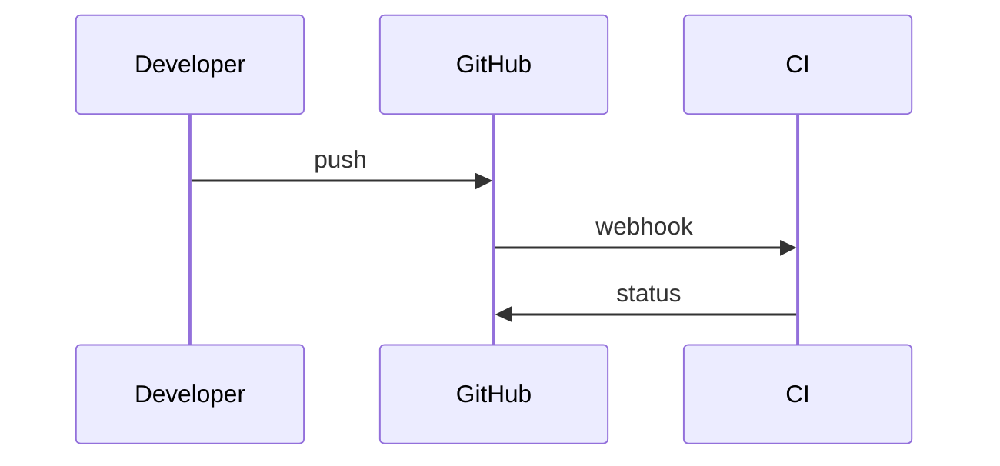

# Diagram walkthrough reference

This is the syntax for animated Mermaid diagrams, as played by `aniflow` and
the sharei reader. Print it with `aniflow --spec`.
Preview a document with `aniflow <dir>` and open the URL it prints. Other
Mermaid renderers, GitHub included, ignore the `%%` lines and draw a plain
diagram.

## Where the script goes

A walkthrough lives inside an ordinary ```` ```mermaid ```` fence, after the
diagram, as `%%` comment lines. Only `flowchart` (or `graph`) and
`sequenceDiagram` play, after optional front matter. Other diagram types get
pan and zoom only.

````markdown
```mermaid
flowchart LR
  U@{ img: "/icons/user.svg", label: "User", w: 48, h: 48, constraint: "on" }
  A@{ img: "/icons/api.svg", label: "API", w: 48, h: 48, constraint: "on" }
  D@{ img: "/icons/database.svg", label: "Database", w: 48, h: 48, constraint: "on" }
  U --> A --> D

%% play: Read a record
%% U -> A : GET | The user asks for a record
%% A -> D : query
%% D -> A : row
%% A -> U : 200 | The answer comes back
```
````

## Directives

```text
%% play: Title            starts a story; the title shows in the story picker
%% A -> B                 a dot travels from node A to node B
%% A -> B : label         the same, with a short tag riding on the dot
%% A -> B : label | text  the same, with a caption shown under the diagram
%% A -> B | text          a caption without a label
%% A -> B, C              one dot down each edge at the same time (fan-out)
%% A, B -> C              dots from A and from B meet at C (fan-in)
%% A -> B & C             same as the comma form
%% A -> B @ok             takes the edge declared in Mermaid as A ok@--> B
%% A -> B @ok, C          an edge id can follow any box in a list
%% skip A B               fades these nodes until the story ends
%% skip A B | text        the same, with a caption
%% wait 1500              holds the picture for 1.5 s before the next step
%% wait 1500 | text       the same, with a caption shown during the wait
```

## Rules

- Steps name nodes by their Mermaid id (the `R` in `R[Run step]`), never by
  their label. `->` and `-->` mean the same thing in a step.
- A step needs an edge between its two nodes. An edge drawn the other way
  (`B --> A`, or `A <--> B`) is followed backwards.
- When several edges join the same two nodes, a plain step takes the first
  one drawn. To choose, give the edges ids in Mermaid
  (`T ok@-->|pass| D` and `T bad@-->|fail| D`) and name one in the step
  (`%% T -> D @ok`). The named edge must join the two nodes of the step.
- In a list, each dot moves at its own edge's pace and the step ends when
  the last dot arrives. The label rides on the first dot only. If any pair
  in the list has no edge, the whole step is dropped. Several boxes on both
  sides (`A, B -> C, D`) is ambiguous and dropped; write one step per edge.
- A caption shows only while its step plays. A step without one hides the
  caption.
- `wait` takes whole milliseconds. Consecutive waits add up, capped at
  10000. A wait after the last step holds the finished picture. Waits follow
  the speed control. Step mode runs through a wait with the step after it.
- Steps written before the first `play:` form a story called Walkthrough.
  Any other `%%` comment is ignored.
- One diagram can hold several stories. Use them for different paths through
  the same picture, with `skip` for the boxes a path does not use.

## Sequence diagrams

The names are participant ids. Each step lights up the next message from the
first participant to the second, counting from the message the previous step
used, and wraps to the top once. The direction must match: `GH -> Dev` never
matches `Dev->>GH`. Self messages (`P -> P`) work. Lists work. Edge ids do
not exist there, so a step with `@id` is dropped.

````markdown

````

## Pictures in boxes

```text
A@{ img: "/icons/agent.svg", label: "Agent", w: 48, h: 48, constraint: "on" }
```

Always set `w`, `h` and `constraint: "on"`, or the picture stretches.
`pos: "t"` puts the label above the picture. Allowed sources:

- a path relative to the document, such as `icons/build.svg`
- a built-in icon, `/icons/<name>.svg` (listed below)
- an `https://` URL
- a `data:image/` URL for PNG, JPEG, GIF, WebP or SVG

Anything else, `http:` included, becomes a grey placeholder, and so does a
picture that fails or takes longer than eight seconds to load. The
diagram's tooltip names them. GitHub cannot reach `/icons/` or relative
pictures inside a diagram; use https pictures when it must look right there.

A custom picture in the same style is a 48×48 SVG: a rounded square tinted
at 12% opacity with a stroked symbol in one colour.

### Built-in icons

Agents and models are violet, waiting and secrets amber, failures and
refusals red, success green, everything else blue.

| Group | Names |
| --- | --- |
| People and agents | `user` `users` `reviewer` `agent` `model` `brain` `skill` `prompt` `sparkles` `tool` |
| Git and forges | `issue` `pull-request` `commit` `branch` `merge` `fork` `repository` `tag` `release` `comment` `review` `diff` `code` `file-code` |
| Events and CI | `event` `webhook` `listener` `trigger` `pipeline` `task` `step` `test` `build` `deploy` `rerun` `follow-up` `schedule` `queue` `wait` `timer` `clock` `check` `success` `fail` `warning` `bug` `fix` `stop` `play` `pause` |
| Platform | `cluster` `node` `pod` `container` `namespace` `service` `network` `ingress` `route` `load-balancer` `database` `storage` `cache` `cloud` `registry` `image` `config` `operator` `controller` `api` `terminal` `cli` `laptop` `phone` `browser` `globe` |
| Security and identity | `identity` `fingerprint` `key` `token` `secret` `unlock` `policy` `shield` `refuse` `audit` `certificate` |
| Data and output | `logs` `report` `document` `folder` `search` `inspect` `metrics` `monitor` `dashboard` `alert` `notification` `mail` `chat` `upload` `download` `link` `filter` `decision` `idea` |

## When a step cannot play

A step that names a missing node, joins two nodes with no edge, names an
unknown edge id or has a `wait` without a number is dropped, and the rest
plays. A warning badge with a count appears in the diagram toolbar; opening
it lists each dropped step with its story, its document line and the reason.
The same list goes to the browser console. A block where no step works gets
the badge and no play button. Check for the badge after every edit.

## Playback and presenting

Playing lights the first node, moves the dot along the edge, ticks the node
it leaves and lights the one it reaches. When the story ends, the final
picture stays. Viewers can step with the arrow keys, change speed, click a
box to spotlight it and its neighbours, draw on the diagram, and save a PNG,
GIF or video.

The Present button turns a document into slides, one per `##` section. A
section holding one diagram and little text fills the screen, and the arrow
keys play its story before moving on.

A link like `#diagram=2&story=1&step=3&focus=A,B` opens the second diagram
in full screen with its first story stopped after three steps and boxes A
and B spotlit. Every part is optional.
